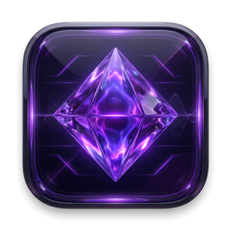
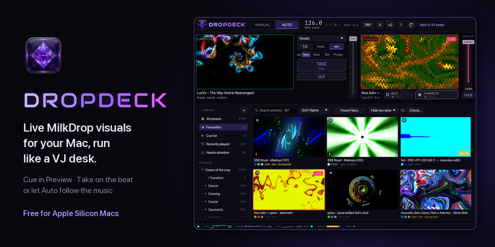

<h1 align="center">DropDeck</h1>

<strong>Live MilkDrop visuals for your Mac, run like a VJ desk.</strong>

DropDeck plays MilkDrop / projectM presets fullscreen on a second screen, such as a projector
or a TV over HDMI, while you control everything from your MacBook. Line up the next visual in
**Preview**, then **Take** it to the audience on the beat. Or switch on **Auto** and let it
follow the music.

The [wiki](https://github.com/iamelwoodblues/DropDeck-releases/wiki) explains every feature and control, top to bottom.

## What you need

- A Mac with Apple Silicon (M1 or later) and macOS 13 or later
- A second display for the visuals. With one screen they play in a window instead.
- MilkDrop presets. They're free, and the welcome screen shows where to get a big pack.

## Get started

### 1. Download the app

1. Download `DropDeck-<version>-macOS-AppleSilicon.zip` from the
   [latest release](https://github.com/iamelwoodblues/DropDeck-releases/releases/latest).
2. Double-click it to unzip, and drag **DropDeck** to your Applications folder.
3. Open it. DropDeck isn't notarised by Apple yet, so the first time macOS refuses to open it.
   Go to **System Settings › Privacy & Security**, scroll down and click **Open Anyway** (on
   macOS 13 and 14 you can Control-click the app and choose **Open** instead). From then on it
   opens normally.

### 2. Import presets

DropDeck doesn't come with presets. The welcome screen points you to a good free pack:

1. Open **[Cream of the Crop](https://github.com/projectM-visualizer/presets-cream-of-the-crop)**
   (about 9,800 presets) and choose **Code › Download ZIP**.
2. Unzip it.
3. On the welcome screen, click **Import presets…** and choose the unzipped folder.

Any folder of `.milk` or `.prjm` files works, including subfolders.

**Importing** copies presets into DropDeck's own library, so the folder you imported from can
go afterwards. Import more any time with **+ › Import presets…** under the Library on the left,
or by dragging a folder onto the window. DropDeck first shows what it found:
- **New presets**, which it copies into a pack you name, keeping their subfolders. A pack shows
  under Folders.
- **Presets already in your library**, which it skips. A preset counts as the same when its
  contents are, whatever it's called. One with the same name but different contents comes in
  as "Name (2)".
- **New textures**, which it copies too.
- **Files only stored online** (iCloud Drive, OneDrive), which it skips: download them in Finder
  first.
- **Presets you deleted before**, which it leaves out unless you tick **Bring them back**.

When it's done it offers to **move the originals to the Trash**. Only files now safely in your
library go; anything else in that folder stays where it is.

**Deleting:** right-click a preset and choose **Delete…**, or right-click a pack or a folder in
one and choose **Delete pack…** / **Delete folder…**. After you confirm, the presets go to the
Trash, their favourites, tags and plays are forgotten, and they leave the cue list and
playlists. Imports skip them from then on. What's live keeps playing until the next take. **Skip
in Auto** is the gentler choice for a preset you just don't want Auto to play.

DropDeck recognises each preset by what's in the file, not what it's called, so its favourite,
tags, play history, speed results and thumbnail stay with it.

**Coming from an older DropDeck** that read preset folders where they were: the first launch
moves those folders into the library, each as a pack. Favourites, tags, thumbnails, the cue list
and playlists come along, and the folders themselves are left as they were. A folder it can't
find is left out: import it when it's back and its details return with it.

### 3. First start

- Allow microphone access when macOS asks, so the visuals can hear the music.
- DropDeck makes thumbnails and checks every preset in the background. If you click
  **Stop output** (top right), it does this much faster.

### 4. Play

- Plug in the second display. The visuals go full screen there. With one display they play in a
  window behind the controls; tick **Keep output on top** in the **Setup** tab to put it in front.
- Click a preset to cue it in **Preview**. Only you can see Preview.
- Press **Space** (or **TAKE**) to blend it onto **PROGRAM**, the output, on the beat.
- Or click **AUTO**, and DropDeck changes presets by itself on the bar or phrase.

Press **?** in the app to see every shortcut. **Full screen** (the arrows at the bottom right, or ⌃⌘F) fills the screen
with the controls, and **Quit** (top right) closes DropDeck.

## What it can do

**Playing visuals**
- Beat-synced transitions, including **Morph**, where the new preset grows out of the old picture
- A T-bar that follows **TAKE** (down on one, back up on the next) and fades by hand, a master fader and fade to black. Moving the master overrides a fade, bringing the output straight back
- Under each monitor, the preset's name and a row of icons (colours, movement, beat, warnings, a star for favourites): rest the mouse on it for everything
- Numbers, words and icons roll into place when they change, a digit at a time, like a departures board
- A speed control that really slows presets down or speeds them up
- Adaptive resolution, so heavy presets stay smooth

**Auto**
- Changes presets every so many beats, bars or phrases, right on the beat
- Plays from whatever the browser shows: a folder, a search, your favourites or a filtered look
- **Hold**: a switch (**H** or the HOLD button) that keeps what's live until you switch it off
- Can leave out heavy presets, flashing presets, presets with missing textures, and presets that black out
- **Match the music**: calmer presets in breakdowns, punchier ones around drops

**Finding presets**
- Rest the mouse on a thumbnail to see it playing live
- Every preset is tagged automatically:
  - its colours
  - its motion: tunnel, spin, kaleidoscope and so on
  - its pace
  - how it follows the beat
  - a ⚠ warning if it flashes
- **Preset Filters** build a set, like "dark, slow tunnels on the beat". Save it as a look.
- Your own tags (#Intro, #Peak…), favourites, a cue list (saved as playlists to recall later)
  and recently played
- Every preset is speed-tested on your Mac and badged **heavy** or **too slow** if needed
- Press **I** on a preset to see all its tags and correct any of them

**On top of the visuals**
- Logo, image, GIF and text overlays, with blend modes, motion (pulse, spin, bounce, ricochet…)
  and an optional outline that keeps them readable over busy or matching colours
- **Melt only**: the preset melts your logo into itself, optionally in the preset's own colours
  so a white logo doesn't white out the picture
- Eight pads that pop a picture on screen (held for up to 20 s) and let the preset melt it away
  as it lets go, or with **On top + melt** melt it in for the whole hold while the crisp copy
  shows for just part of it; any pad can also fire by itself on a repeat timer, with a
  countdown on the pad
- Eight FX buttons: strobe, hue, invert, mirrors, quad, kaleido and prism

**Music**
- Any audio input, or **This Mac's audio**: whatever is playing on the Mac (Spotify, a DJ app, a
  browser), with no extra driver (macOS 14.2 or later)
- Automatic BPM and downbeat detection, plus tap tempo and a ⟳ re-detect button
- A sync test to line the beat up with your projector's delay

**Control**
- MIDI controllers work straight away, and **MIDI learn** maps any button or fader
- **Phone remote**: run the show from your phone's browser on the same Wi-Fi: take, cut, hold,
  blackout and master, FX (and their set-up), pads, the preset browser (tap three times to
  take a preset), tap tempo and the Mac's audio gain (tap the BPM), and the Mac's stats. Turn it
  on and scan the QR code in **Control › Phone remote**.

**Built for live use**
- The visuals run in a separate process. If a preset crashes, the controls keep working and the
  output is back within a second.
- Broken or slow presets are flagged and kept out of Auto
- The status bar shows frame rate, heat, audio level and stutters

## Tips for a MacBook Air

The Air has no fan, so it slows down when it gets hot.

- Watch the **HEAT** dot in the status bar. If it turns amber or red, lower the resolution
  (1080p or 720p) or set the **FPS cap** to 30 in the Setup tab.
- Leave **Half-rate Preview**, **Adaptive resolution** and **Avoid heavy presets** on.
- Before a gig, stop the output and let DropDeck check the whole library. Then set the filter
  to **Smooth only** for a set that never struggles.

## Where your things are kept

| What | Where |
|---|---|
| Settings | `~/Library/Application Support/DropDeck/settings.json` |
| Favourites, tags, play counts and speed results | `~/Library/Application Support/DropDeck/library.sqlite` |
| Imported presets and their textures | `~/Library/Application Support/DropDeck/Presets/` and `Textures/`, a folder per pack (right-click a pack › **Reveal in Finder**) |
| Thumbnails | `~/Library/Caches/DropDeck/thumbs/` |
| Logs | `~/Library/Logs/DropDeck/` (the Performance panel, opened from the status bar, has an **Open log folder** button) |

## Licences

- **DropDeck** is free to download and use. Its source code isn't public.
- **projectM:** DropDeck includes libprojectM 4.1.8 (LGPL-2.1) with DropDeck's changes, linked
  dynamically: it's `DropDeck.app/Contents/Frameworks/libprojectM-4.4.dylib` and can be
  replaced. Each release has its complete source with those changes attached
  (`projectm-4.1.8-dropdeck-source.tar.gz`). The changes on their own, and the script that applies
  them and builds the library, are in [`projectm/`](projectm/). The licence is in
  [`LICENSES/projectM-LGPL-2.1.txt`](LICENSES/projectM-LGPL-2.1.txt).
- **Audiowide font** (the DROPDECK name) by Astigmatic, under the SIL Open Font License 1.1:
  [`LICENSES/Audiowide-OFL.txt`](LICENSES/Audiowide-OFL.txt), also inside the app.
- **Phosphor Icons** (the icons) under the MIT licence:
  [`LICENSES/Phosphor-Icons-MIT.txt`](LICENSES/Phosphor-Icons-MIT.txt), also inside the app.
- **Textures and presets:** the texture pack inside the app, and the Cream of the Crop presets the
  welcome screen points to, come from the projectM project. Per projectM, MilkDrop presets were
  released freely by their authors and are treated as public domain.
